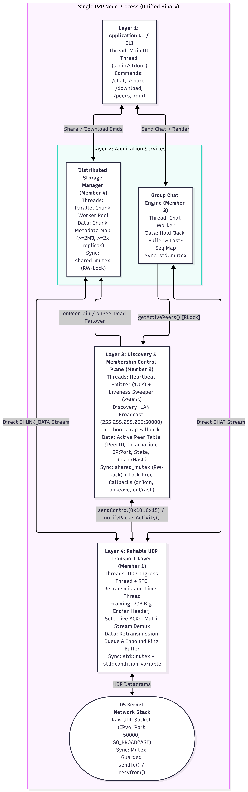

# Layered System Architecture & Concurrency Threading Model (CN WP7)

## 1. Internal Architectural Layers
1. **Application UI / CLI:** Handles user commands (`/chat`, `/share`, `/download`, `/peers`, `/quit`) and renders ordered messages, progress updates, and peer status notifications on the **Main UI Thread**.
2. **Group Chat Engine (Member 3):** Enforces causal/FIFO per-sender ordering and duplicate suppression before fanning out chat payloads to active peers.
3. **Distributed Storage Manager (Member 4):** Splits files ($\ge 2\text{ MB}$) into fixed chunks, maintains $\ge 2\times$ replication, executes parallel multi-source downloads, and triggers replica failover on `onPeerDead()` events.
4. **Peer Discovery & Membership Manager (Member 2):** Runs hybrid discovery (UDP LAN Broadcast + `--bootstrap` unicast fallback), executes the `DISCOVER` $\rightarrow$ `PEER_LIST` $\rightarrow$ `JOIN` $\rightarrow$ `JOIN_ACK` handshake, and monitors peer liveness ($T_{\text{hb}} = 1.0\text{ s}$, $T_{\text{dead}} = 3.5\text{ s}$).
5. **Reliable UDP Transport Layer (Member 1):** Manages the 20-byte Big-Endian common header, selective/cumulative ACKs, RTO timers, multi-stream demultiplexing, and implicit packet-activity piggybacking over a single raw UDP socket.

## 2. Shared Data Structures & Thread-Synchronization Boundaries
- **Active Peer Table (Member 2):** Guarded by a Read-Write lock (`shared_mutex`), allowing concurrent reads (`getActivePeers()`) from Chat and Storage while the `250 ms` Liveness Sweeper and UDP Ingress thread acquire exclusive write locks for state transitions (`ALIVE` $\rightarrow$ `SUSPECT` $\rightarrow$ `DEAD`).
- **Chunk Metadata Map (Member 4):** Guarded by a Read-Write lock (`shared_mutex`) to coordinate parallel chunk workers and instant replica failover upon `onPeerDead()` callbacks.
- **Hold-Back Buffer (Member 3):** Guarded by a `mutex` to enforce per-sender FIFO sequence ordering and duplicate suppression for group chat messages.
- **Retransmission Queue (Member 1):** Guarded by a `mutex` + `condition_variable` waking the RTO Timer and UDP Ingress threads for reliable multi-stream UDP framing.
